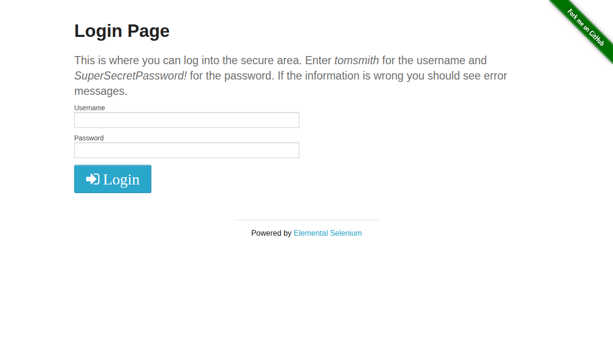

# QA Automation Portfolio

**English** | [Bahasa Indonesia](README.id.md)

[](https://github.com/anonbanana/qa-automation-portfolio/actions/workflows/ci.yml)

Basic-level QA automation portfolio (ISTQB Foundation Level) built with Playwright against [the-internet.herokuapp.com](https://the-internet.herokuapp.com) — a free public practice site.

## About this project

I designed test cases and automated them using Playwright. The scope is deliberately kept at foundation level:

- Clear test flows: login, forms, checkboxes, dropdown, dynamic elements, JavaScript alerts, file download, iframes.
- Simple test design techniques: **equivalence partitioning** and **boundary value analysis** (applied to the login form and number input tests).
- Visible results: HTML report + automatic screenshots on failure.



## Tech stack

| Component | Choice |
|---|---|
| Automation framework | Playwright Test (JavaScript) |
| Browser | Chromium |
| CI | GitHub Actions |
| System under test | the-internet.herokuapp.com |

## Repository structure

```
├── tests/                  # 25 automated test cases (9 modules)
│   ├── login.spec.js               # form authentication
│   ├── checkboxes.spec.js          # check / uncheck
│   ├── dropdown.spec.js            # dropdown selection
│   ├── inputs.spec.js              # number input (validation)
│   ├── add-remove-elements.spec.js # dynamic elements
│   ├── javascript-alerts.spec.js   # alert, confirm, prompt
│   ├── broken-images.spec.js       # broken image detection
│   ├── file-download.spec.js       # file download
│   └── frames.spec.js              # content inside an iframe
├── test-cases/
│   └── test-cases.md       # written (manual) test case examples
├── reports/
│   └── bug-report-example.md # example defect report
├── docs/screenshots/       # page screenshots used in this README
└── .github/workflows/ci.yml # tests run automatically on every push
```

## How to run

```bash
# 1. install dependencies
npm install

# 2. install the browser (once)
npx playwright install chromium

# 3. run all tests
npm test

# 4. open the HTML report
npm run report
```

## Test coverage

| Module | Scenarios | Tests |
|---|---|---|
| Login | valid login, wrong password, wrong username, form labels | 4 |
| Checkboxes | initial state, uncheck, check | 3 |
| Dropdown | initial state, select Option 1, select Option 2 | 3 |
| Inputs | valid number, text rejected by browser, large number bound | 3 |
| Add/Remove Elements | add 1, add 3, delete 1 | 3 |
| JavaScript Alerts | alert accept, confirm accept, confirm dismiss | 3 |
| Broken Images | image count, broken image detection | 2 |
| Download | download a file, file list on page | 2 |
| iFrame | page heading, default editor content | 2 |

**Total: 25 test cases**

## Screenshots

| Checkboxes | JavaScript Alerts | Download |
|---|---|---|
|  |  |  |

## Notes

- The target site runs on a free Heroku dyno — it falls asleep, so the first request is slow. Timeouts are configured accordingly, and CI warms the site up before running tests.
- Some tests may report as *flaky* (passing on retry) due to server slowness, not test defects. This is documented as part of the real-world testing experience.
