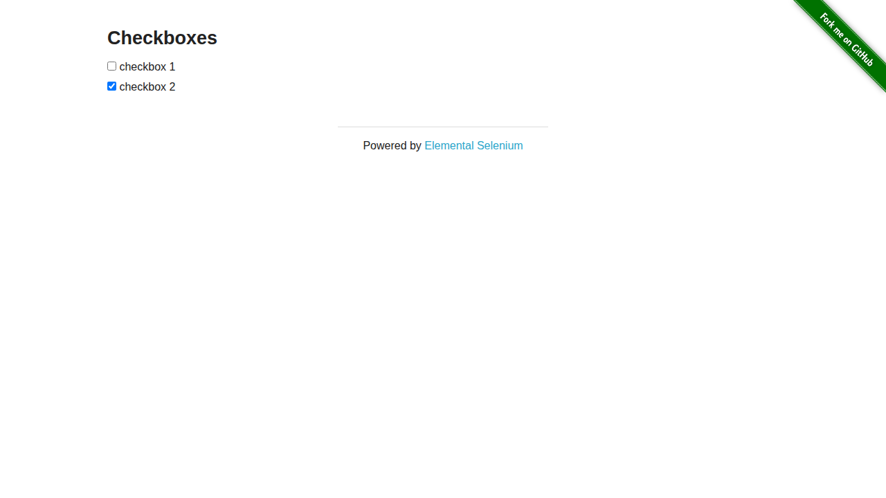
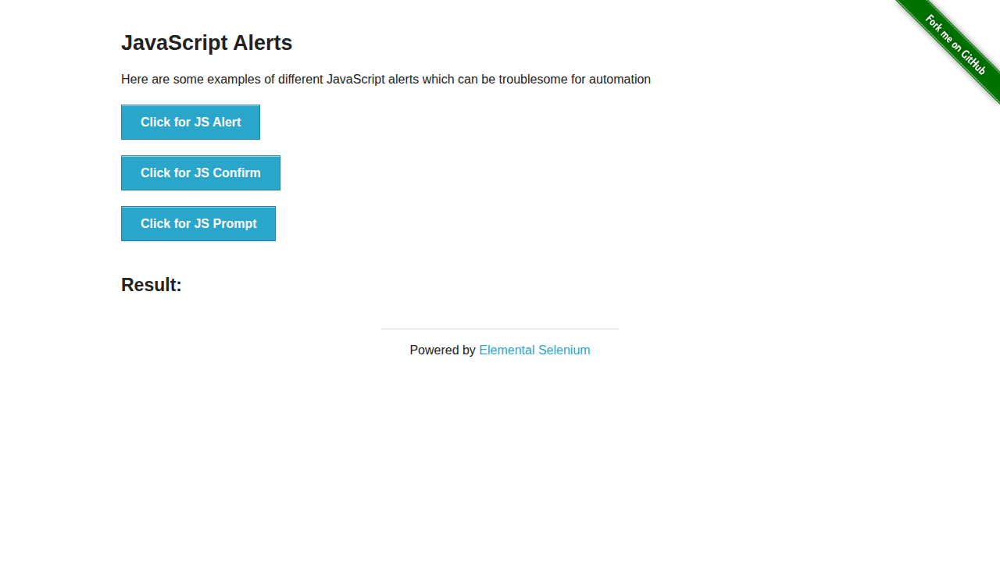
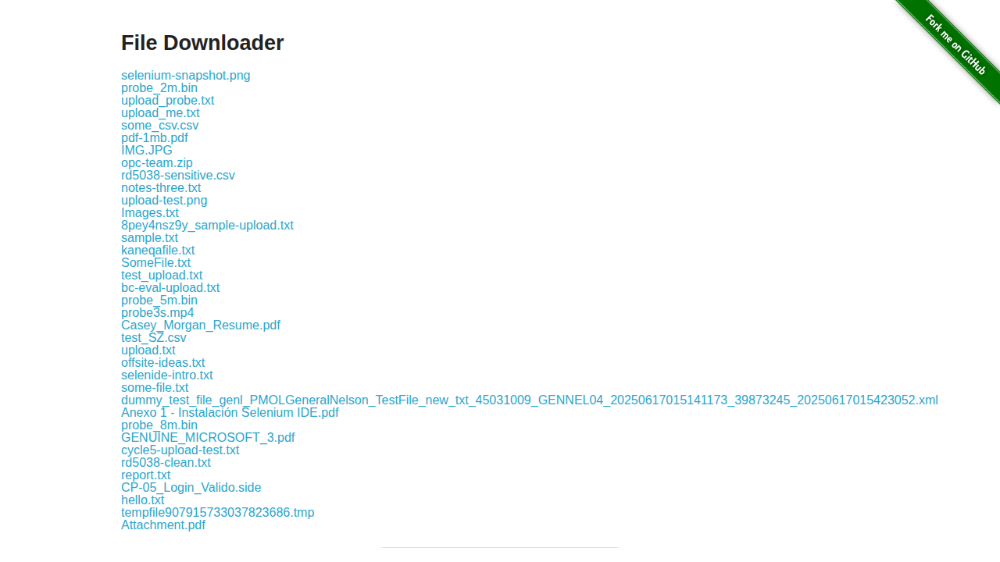

# QA Automation Portfolio

**English** | [Bahasa Indonesia](README.id.md)

[](https://github.com/anonbanana/qa-automation-portfolio/actions/workflows/ci.yml)

QA automation portfolio applying ISTQB Foundation Level test design principles to [the-internet.herokuapp.com](https://the-internet.herokuapp.com) — a free public practice site.

## About this project

I designed 36 test cases and automated them with Playwright. The scope stays at foundation level, but the artifacts are complete: written test cases, a traceability matrix, a test plan, a defect report, and a test summary report.

- **36 automated tests** across 9 modules.
- **Test design:** equivalence partitioning, boundary checks on dynamic element counts, negative testing, and state transition.
- **Maintainable automation:** Page Object Model plus a Playwright fixture.
- **Visible results:** HTML report, screenshots and traces on failure.
- **CI:** GitHub Actions runs the suite on pushes to `main` and on pull requests targeting `main`.

## Latest result

| Date | Tests | Result | Notes |
|---|---:|---|---|
| 2026-10-20 | 36 | **36 passed, 0 failed, 0 flaky** | 2 consecutive local runs, retries 0 |

The full execution record is in [`reports/test-summary-report.md`](reports/test-summary-report.md).

## Tech stack

| Component | Choice |
|---|---|
| Automation framework | Playwright Test (JavaScript) |
| Browser | Chromium |
| CI | GitHub Actions |
| System under test | the-internet.herokuapp.com |
| Pattern | Page Object Model + fixture |

## Repository structure

```
├── pages/                         # Page Object Model
├── fixtures/pages.js              # Playwright fixture for page objects
├── support/test-data.js           # Test data and expected strings
├── tests/                         # 36 automated tests (9 modules)
│   ├── login.spec.js              # form authentication + negative cases
│   ├── checkboxes.spec.js         # check / uncheck
│   ├── dropdown.spec.js           # dropdown selection + option list
│   ├── inputs.spec.js             # number input (valid, invalid, special values)
│   ├── add-remove-elements.spec.js # dynamic elements + count boundary
│   ├── javascript-alerts.spec.js  # alert, confirm, prompt
│   ├── broken-images.spec.js      # broken image detection
│   ├── file-download.spec.js      # file download + content size
│   └── frames.spec.js             # content inside an iframe
├── test-cases/
│   └── test-cases.md              # 36 written cases + traceability matrix
├── docs/
│   └── test-plan.md               # scope, risks, entry/exit criteria
├── reports/
│   ├── bug-report-example.md      # defect & environment report
│   └── test-summary-report.md     # execution result and conclusion
├── docs/screenshots/              # page screenshots used in this README
└── .github/workflows/ci.yml       # tests run automatically on every push
```

## Test design

| Technique | Where it is applied |
|---|---|
| Equivalence partitioning | Login (valid, wrong password, wrong username); inputs (number vs text) |
| Boundary value analysis | Add/Remove element count: 0 → 1 → 2 → 1 → 0 |
| Negative testing | Empty fields, whitespace-only fields, case-sensitive username, non-numeric input |
| State transition | Checkbox states, dropdown values, alert/confirm/prompt results |

> The `/inputs` page has no `min` or `max`. For that page, `9999` is a **large-value robustness test**, not a boundary value test. I keep this distinction explicit so the technique labels match the actual tests.

## Test coverage

| Module | Scenarios | Tests |
|---|---|---:|
| Login | valid login, wrong password, wrong username, labels, empty fields, whitespace, case sensitivity | 8 |
| Checkboxes | initial state, uncheck, check | 3 |
| Dropdown | initial state, select Option 1, select Option 2, option list | 4 |
| Inputs | valid number, text rejected, large value, zero, negative, decimal | 6 |
| Add/Remove Elements | add 1, add 3, delete 1, delete back to zero | 4 |
| JavaScript Alerts | alert accept, confirm accept, confirm dismiss, prompt accept, prompt dismiss | 5 |
| Broken Images | image count, broken image detection | 2 |
| Download | download one file with content check, file list | 2 |
| iFrame | page heading, default editor content | 2 |

**Total: 36 test cases**

## Screenshots

| Checkboxes | JavaScript Alerts | Download |
|---|---|---|
|  |  |  |

## How to run

```bash
# 1. install dependencies
npm ci

# 2. install the browser (once)
npx playwright install chromium

# 3. run all tests (local retries = 0)
npm test

# 4. open the HTML report
npm run report
```

Want to see the browser move?

```bash
npm run test:headed
```

## Reports and documentation

- [Test plan](docs/test-plan.md) — scope, risks, entry/exit criteria.
- [Test cases + traceability](test-cases/test-cases.md) — 36 cases mapped to spec files.
- [Defect report](reports/bug-report-example.md) — `ENV-001` and `BUG-002`.
- [Test summary report](reports/test-summary-report.md) — execution result and conclusion.

## Notes and limitations

- The target site runs on a free Heroku dyno and may fall asleep. CI warms up all nine pages before running tests.
- Local runs use `retries: 0` so flakiness is visible. CI uses `retries: 2` only for network instability, and the summary report records the flaky count.
- `ENV-001`: the TinyMCE editor is read-only because the third-party free quota is exhausted. The suite verifies the default content only.
- `BUG-002`: the checkboxes have visible text but no programmatic label, so their accessible name is empty.
- Out of scope: performance, security penetration, API, cross-browser, mobile, full accessibility audit, and visual regression.

## License

[MIT](LICENSE)
